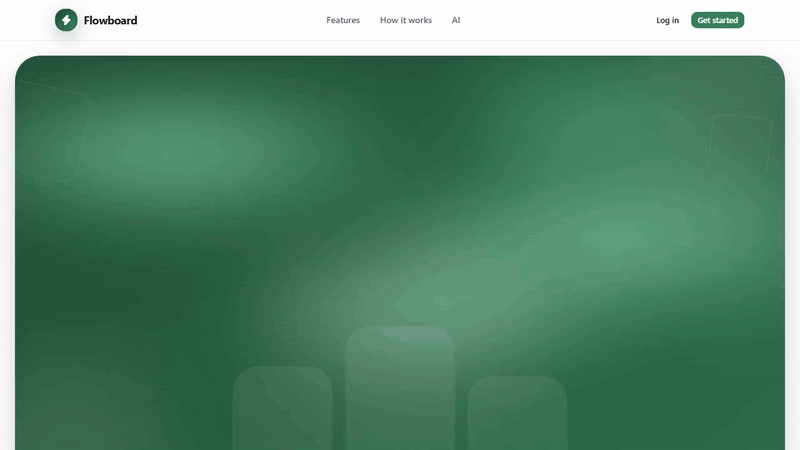

# kanban

**Flowboard** is a collaborative kanban board with AI task planning. A team organises work in boards of columns and tasks, sees each other's changes the moment they happen, and can describe a goal in a sentence to get a drafted backlog that it reviews before anything is saved.

It is a full-stack TypeScript project: a React single-page app and a NestJS API on PostgreSQL, sharing typed contracts, in one pnpm and Turborepo workspace. Built to be maintained, not only to run: tested at every level, checked for accessibility, and gated by a CI pipeline.

**Live demo: <https://kanban.x10w1hqvjn1e6.eu-north-1.cs.amazonlightsail.com>** (press **Try the demo** on the sign-in page).



Screenshots are in [docs/images](docs/images): the landing page, the dashboard, the board in both themes and on a phone, and the AI step.

## Features

- **Boards:** columns and tasks with a priority, an assignee and a due date. Cards move by pointer or by keyboard, and columns can be added, renamed and removed.
- **Live updates:** a teammate's change appears on your board without a reload, and you see who else is viewing.
- **Teams:** invite people to a board as owner, admin or member; the API enforces what each may do, and the UI hides what it would refuse. Every board has an activity log and a summary.
- **AI:** describe a goal and review the drafted tasks before anything is saved, break one task into subtasks, or summarise a board's progress.
- **Around the boards:** a dashboard, My tasks, a calendar of due dates, a team page and a command menu (Ctrl K).
- **Everywhere:** light and dark themes, a layout that fits a phone, and keyboard access throughout.

## What is worth a look

- **One contract:** the API's OpenAPI document is generated and checked in CI, and the web app calls the API only through the typed client made from it.
- **Tested at every level:** unit tests, API end-to-end tests on a real PostgreSQL, browser tests in Chromium, Firefox and WebKit, accessibility scans in both themes, and Lighthouse thresholds.
- **A gated pipeline:** lint, types, tests and build must pass, with pinned actions, Trivy, CodeQL and gitleaks scans, and a commit-message check. The repository rules are in `.github/rulesets/main.json`.
- **Written down:** the reasons for the main choices are in [docs/decisions.md](docs/decisions.md), the system map in [docs/architecture.md](docs/architecture.md) and the known gaps in [docs/known-limitations.md](docs/known-limitations.md).

## Stack

- **Web:** React 19, Vite, react-router, TanStack Query, Tailwind and shadcn (in `packages/ui`).
- **API:** NestJS, Prisma, PostgreSQL, better-auth, OpenAPI.
- **Quality:** Vitest, Testcontainers, Playwright, axe, Lighthouse, GitHub Actions.

## Layout

| Path                  | What it holds                                                                                        |
| --------------------- | ---------------------------------------------------------------------------------------------------- |
| `apps/web`            | The single-page app                                                                                  |
| `apps/backend`        | The API                                                                                              |
| `packages/ui`         | shadcn components, blocks, theme                                                                     |
| `packages/api-client` | Typed client generated from the API's OpenAPI document                                               |
| `packages/shared`     | Contracts and permissions used by both apps                                                          |
| `docs`                | [Decisions](docs/decisions.md), [known limitations](docs/known-limitations.md), the OpenAPI document |

## Run it locally

Needs Node 24, pnpm and Docker.

```sh
pnpm install
cp apps/backend/.env.example apps/backend/.env
cp apps/web/.env.example apps/web/.env
pnpm db:up
pnpm db:deploy
pnpm dev
```

The web app runs on http://localhost:3100 and the API on http://localhost:3001 (docs at `/docs`).

## Commands

| Command                  | What it does                                      |
| ------------------------ | ------------------------------------------------- |
| `pnpm dev`               | Run every app in watch mode                       |
| `pnpm lint`              | Lint                                              |
| `pnpm check-types`       | Type-check                                        |
| `pnpm test`              | Unit tests                                        |
| `pnpm build`             | Build everything                                  |
| `pnpm api:generate`      | Rebuild the OpenAPI document and the typed client |
| `pnpm db:up` / `db:down` | Start or stop the local database                  |

Per-app scripts, environment and structure are in `apps/backend/README.md` and `apps/web/README.md`. Contributor and agent rules are in [AGENTS.md](AGENTS.md).
