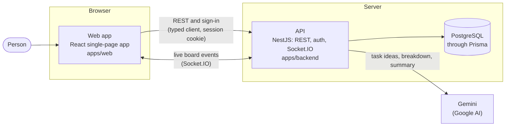
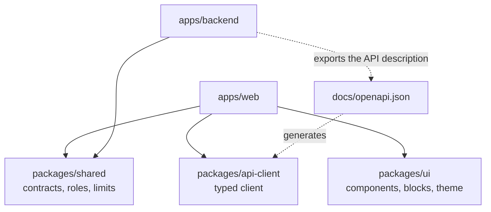
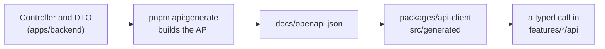
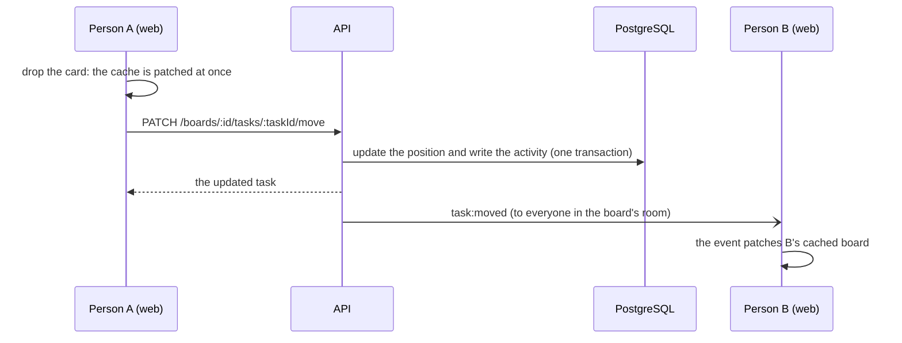

# Architecture

The map of the codebase: what the pieces are, how they connect and where to look. Read it first; the reasons behind the larger choices are in [decisions.md](decisions.md), and what is deliberately missing is in [known-limitations.md](known-limitations.md).

Keep it current: a pull request that adds or moves an app, package, web feature or API module updates the [codemap](#codemap) in the same pull request, and `pnpm docs:check` fails when one is missing.

## The system

A person uses the web app in a browser. It talks to one API over HTTPS with a session cookie, and over a socket for live board updates. The API stores everything in PostgreSQL and asks a language model for the AI features.

## How the packages connect

`@repo/shared` is the one place both sides agree: the response contracts, the board roles and who may do what, and the input limits. The web app never writes a URL or a response type by hand; both come from the generated client.

## Codemap

### Repository root

| Path                                      | What it holds                                                                     |
| ----------------------------------------- | --------------------------------------------------------------------------------- |
| `package.json`, `turbo.json`              | The workspace scripts and the Turborepo task graph                                |
| `pnpm-workspace.yaml`                     | The workspace, and the `catalog:` that holds every dependency version             |
| `.github/workflows`                       | CI, security scans and accessibility                                              |
| `.github/rulesets`, `.github/settings.sh` | The branch rules and repository settings, applied with the CLI                    |
| `docs`                                    | This map, the decisions, the known limitations and the generated OpenAPI document |
| `scripts`                                 | Repository scripts, such as the check that this map is complete                   |
| `compose.yaml`                            | The local PostgreSQL                                                              |

### `apps/backend`: the API

Start at `src/main.ts` (boots the app), then `src/app.module.ts` (lists the modules).

| Path                                                     | What it holds                                                                                             |
| -------------------------------------------------------- | --------------------------------------------------------------------------------------------------------- |
| `src/env.ts`                                             | The validated environment; the only place that reads `process.env`                                        |
| `apps/backend/src/modules/board`                         | The realtime gateway (`board.gateway.ts`): rooms per board, presence and the events the services emit     |
| `apps/backend/src/modules/column`                        | Columns of a board; a column with tasks cannot be deleted                                                 |
| `apps/backend/src/modules/task`                          | Tasks, including moving one, and the checks that the column and the assignee are on the board             |
| `apps/backend/src/modules/ai`                            | Task generation, breakdown and board summary, through the model provider                                  |
| `apps/backend/src/modules/user`                          | Searching accounts to invite                                                                              |
| `apps/backend/src/modules/health`                        | Liveness and readiness (readiness asks the database)                                                      |
| `src/lib/auth`                                           | The sign-in setup (email and password, optional Google) and its rate limits                               |
| `src/openapi.ts`, `export-openapi.ts`                    | The OpenAPI document: served at `/docs` outside production, written to `docs/openapi.json` for the client |
| `src/lib/database`                                       | The shared Prisma service                                                                                 |
| `prisma`                                                 | `schema.prisma` (auth, boards, columns, tasks, activity); the migrations are committed beside it          |
| `src/lib/serialization`                                  | Converts database decimals to numbers at the boundary                                                     |
| `src/lib/filters`, `interceptors`                        | The error shape and the `{ success, data }` envelope, applied to every route                              |
| `src/lib/logger`, `request-id`, `rate-limit`, `shutdown` | Logging, request ids, the default rate limit, graceful shutdown                                           |
| `src/lib/web`                                            | Serves the built web app from the API's own address, and sets the security headers                        |
| `Dockerfile`                                             | The production image of the API (Node 24, non-root); it applies the migrations when it starts             |
| `src/instrumentation.ts`                                 | OpenTelemetry tracing, started only when an endpoint is configured                                        |
| `scripts/seed.ts`                                        | An account for each role and, outside production, a sample board                                          |
| `test`                                                   | Tests that boot the app                                                                                   |

A module is a controller (routes), a service (rules), DTOs (request schemas), and a `*.responses.ts` (what the route answers, which also feeds the generated client).

### `apps/web`: the single-page app

Start at `src/main.tsx` (mounts the app), `src/components/providers.tsx` (theme, query cache, motion, toasts) and `src/router.tsx` (every route).

| Path                              | What it holds                                                                                                        |
| --------------------------------- | -------------------------------------------------------------------------------------------------------------------- |
| `src/pages`                       | One file per route; they compose features and hold no data logic                                                     |
| `src/layouts`                     | The signed-in shell: session guard, sidebar with the boards, user menu, command menu entry                           |
| `apps/web/src/features/boards`    | Boards and the kanban board: `api` (calls), `hooks` (queries, mutations, realtime), `lib` (pure logic), `components` |
| `apps/web/src/features/tasks`     | Tasks: the dialog and form, the mutations, due dates and priorities                                                  |
| `apps/web/src/features/ai`        | The AI dialogs and their hooks: draft tasks from a goal, break a task down, summarize the board                      |
| `apps/web/src/features/workspace` | My tasks, Calendar and Team: reads every board and combines the results                                              |
| `apps/web/src/features/landing`   | The public page: navbar, hero, features, how it works, the AI section and the footer                                 |
| `apps/web/src/features/users`     | The avatar                                                                                                           |
| `src/lib`                         | The API and auth clients (the session-ended handling is here) and the safe return address after sign-in              |
| `src/providers`                   | The query client                                                                                                     |
| `src/hooks`                       | Hooks used across pages, such as the page title                                                                      |
| `src/env.ts`                      | The validated environment (`VITE_*` values are public: Vite inlines them)                                            |
| `e2e`                             | Playwright specs: sign-up and sign-in, public-page accessibility, every signed-in page                               |
| `src/router.tsx`                  | The routes, and the boundary that shows a message when a page fails to render and clears it on navigation            |

A feature folder keeps its own layers: `api` is the only place that calls the client, `hooks` hold queries and mutations, `lib` is pure and tested, `components` are presentational.

### `packages`

| Path                         | What it holds                                                                                                         |
| ---------------------------- | --------------------------------------------------------------------------------------------------------------------- |
| `packages/ui`                | The design system: the theme (`src/globals.css`), shadcn components (`src/components`), blocks (`src/blocks`)         |
| `packages/shared`            | Response contracts (`src/contracts`), board roles and permissions, input limits. Built to `dist`, which the API loads |
| `packages/api-client`        | The typed client; `src/generated` is written by `pnpm api:generate` and never edited by hand                          |
| `packages/eslint-config`     | The shared ESLint configs                                                                                             |
| `packages/typescript-config` | The shared `tsconfig` bases                                                                                           |

## Main flows

### A route change reaches the web app

CI regenerates the description and fails when the committed files differ, so the contract cannot drift.

### Signing in, and the session ending

The web app signs in through the auth client; the API sets a session cookie. Every signed-in page sits under the shell layout, which redirects to sign-in when there is no session. When any API call answers 401, the API client asks the session store to look again, the layout clears the cache and redirects. The API closes a socket whose session has ended, checking every 30 seconds. ([decision 9](decisions.md#9-a-session-that-ends-is-noticed-everywhere-it-was-in-use))

### Moving a card, live

A failed move rolls A's cache back and shows a toast.

## Rules that cross modules

- **Who may do what** is defined once in `packages/shared` (roles: owner, admin, member) and enforced by the API guard; the UI reads the same definition to hide actions.
- **Responses** are `{ success: true, data }` or `{ success: false, error }`; the same schemas describe them in OpenAPI and parse them in tests.
- **Dates:** an instant is an ISO timestamp; a calendar day (a due date) is a date at UTC midnight, sent as `YYYY-MM-DD`.
- **Numbers:** database decimals are converted to numbers at the API boundary (`src/lib/serialization`).
- **Order** inside a column is a decimal position; appending adds 1000.
- **A column with tasks cannot be deleted;** the UI explains why and the API refuses.
- **Configuration** is read only through the two validated env modules, and a new variable goes in the schema and in `.env.example`.
- **Live events:** `task:created`, `task:updated`, `task:moved`, `task:deleted`, `column:created`, `column:updated`, `column:deleted`, `board:updated` carry the full updated object; the web app patches its cache with them.

## Where to look

| I want to change…                        | Start here                                                                                            |
| ---------------------------------------- | ----------------------------------------------------------------------------------------------------- |
| A route or its answer                    | `apps/backend/src/modules/<module>` (DTO and `*.responses.ts`), then `pnpm api:generate`              |
| Who may do what                          | `packages/shared/src/board-role.ts`, `apps/backend/src/modules/board/board.guard.ts`                  |
| A text length limit                      | `packages/shared/src/limits.ts`                                                                       |
| The database                             | `apps/backend/prisma/schema.prisma` plus a new migration                                              |
| What a screen shows                      | `apps/web/src/pages/<page>.tsx`, then `apps/web/src/features/<feature>`                               |
| How the board moves and updates          | `apps/web/src/features/boards` (`components/kanban-board.tsx`, `hooks/use-board-realtime.ts`)         |
| Colours, spacing, dark mode              | `packages/ui/src/globals.css`                                                                         |
| A button, dialog or other component      | `packages/ui/src/components`, composed blocks in `packages/ui/src/blocks`                             |
| The live events                          | `apps/backend/src/modules/board/board.gateway.ts`, `apps/web/src/features/boards/lib/board-events.ts` |
| Environment variables                    | `apps/backend/src/env.ts`, `apps/web/src/env.ts`, and the `.env.example` next to each                 |
| CI, security scans, deploys              | `.github/workflows`                                                                                   |
| How it is put live, and the variables    | [deploying.md](deploying.md), `render.yaml`, `apps/backend/Dockerfile`                                |
| The branch rules and repository settings | `.github/rulesets/main.json`, `.github/settings.sh`, [CONTRIBUTING.md](../CONTRIBUTING.md)            |
| Demo data                                | `apps/backend/scripts/seed.ts`                                                                        |
